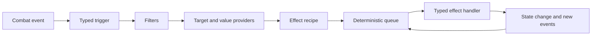

<div align="center">

# ⚙️ RogueDeck Core

### Build the mechanic. Keep the core clean.

A deterministic, modular C# combat engine for roguelike deckbuilders — built to absorb strange mechanics without becoming a giant switch statement.

<br>

<a href="https://github.com/Paranoidgrinch/RogueDeck-Core">
  
</a>
<a href="https://github.com/Paranoidgrinch/RogueDeck-Core/blob/main/docs/architecture.md">
  
</a>
<a href="https://moonvineforge.com/card-forge.html">
  
</a>

<br><br>

[](https://github.com/Paranoidgrinch/RogueDeck-Core/actions/workflows/ci.yml)


</div>

---

## The rule above all others

> **Adding a new effect must not require changing the central resolver.**

RogueDeck Core is being built around composition rather than special cases:

* no central switch over concrete effects
* no hardcoded `PoisonStacks`, `IsStunned` or `Thorns` fields
* no game-specific rules hidden inside turn processing
* no effects bypassing the deterministic queue
* no unrelated systems changing whenever a new mechanic appears

A mechanic should join the engine through focused definitions, handlers, providers and packages — not by teaching the entire core what that mechanic is.

---

## Compose mechanics instead of hardcoding them

Triggered mechanics are separated into five questions:

```text
WHEN       What happened?
IF         Which conditions must match?
WHO        Which combatants are affected?
HOW MUCH   How is the value calculated?
WHAT       Which primitive effect is requested?
```

That means an existing event can be combined with an existing effect without requiring another event-specific engine class.

Examples:

```text
WHEN damage is received
IF the target has Thorns
WHO the attacker
HOW MUCH the current Thorns value
WHAT deal damage
```

```text
WHEN a skill card is played
IF it is the second skill this turn
WHO the player
HOW MUCH 1
WHAT draw cards
```

The content describes the interaction.

The engine resolves it.

---

## How resolution works



Effects and events continue through the queue until the chain is complete or combat ends.

Chain ancestry, re-entry rules and configurable depth limits keep reactive mechanics powerful without allowing accidental infinite loops.

---

## Current capabilities

The combat core currently includes:

* deterministic combat state and seeded random behaviour
* modular effect-request and handler registries
* ordered effect and event queues
* turn, round and combat-result lifecycles
* cards, card instances and card zones
* draw, discard, exhaust, banish and retain behaviour
* card costs and cost modifiers
* reusable resources and resource lifecycles
* status definitions, stacking, duration and charges
* damage, healing, block and defensive pools
* typed target selectors and value providers
* card, status, resource and lifecycle triggers
* multi-target card behaviour
* effect-chain causality and re-entry protection
* package-based registration
* combat logging
* architecture guard tests
* extensive behavioural and integration tests

---

## What RogueDeck Core is not

RogueDeck Core is currently an **engine architecture project**, not a playable game.

The present focus is the reusable combat language beneath a roguelike deckbuilder.

The core deliberately does not contain:

* rendering
* animations
* input handling
* a fixed user interface
* game-specific visual assets
* hardcoded classes, worlds or themes

A console sandbox exists for development, but the engine is designed to sit beneath different front ends and different games.

---

## Run the project

### Requirements

* [.NET 10 SDK](https://dotnet.microsoft.com/download/dotnet/10.0)
* Git

### Clone and validate

```bash
git clone https://github.com/Paranoidgrinch/RogueDeck-Core.git
cd RogueDeck-Core
dotnet restore
dotnet test
```

The CI workflow restores, builds and tests the solution on every push and pull request to `main`.

---

## Repository structure

```text
RogueDeck-Core
├── src
│   ├── RogueDeck.Core
│   │   └── Combat
│   │       ├── Cards
│   │       ├── Effects
│   │       └── Resources
│   └── RogueDeck.ConsoleSandbox
├── tests
│   └── RogueDeck.Core.Tests
├── docs
│   ├── architecture.md
│   └── combat-effect-recipes.md
└── .github
    └── workflows
        └── ci.yml
```

---

## Architecture documentation

### [Core architecture](https://github.com/Paranoidgrinch/RogueDeck-Core/blob/main/docs/architecture.md)

Combat state, effect handlers, queues, events, packages, lifecycle rules and the boundaries of the engine.

### [Combat-effect recipes](https://github.com/Paranoidgrinch/RogueDeck-Core/blob/main/docs/combat-effect-recipes.md)

The typed recipe system, value providers, trigger composition, effect-chain causality and re-entry policies.

---

## Where it came from

RogueDeck Core grew out of the first playable systems beta of:

### 🧙 [Bureaucrats and Broomsticks](https://github.com/Paranoidgrinch/bureaucrats-and-broomsticks-v2)

A satirical fantasy roguelike deckbuilder about magic, paperwork and deeply questionable career choices.

Building a complete game revealed the cost of tightly coupled effects and event-specific action classes.

RogueDeck Core is the answer:

> Build the next mechanic without making the previous hundred harder to understand.

<a href="https://github.com/Paranoidgrinch/bureaucrats-and-broomsticks-v2/releases/latest">
  
</a>

---

## Try to break the architecture

Have an idea for a mechanic that should be difficult to represent?

Submit a:

* card
* relic
* status
* resource
* curse
* enemy action
* triggered interaction
* completely unreasonable combat rule

The most useful ideas are not necessarily balanced.

They are the ones that force the engine to prove its modularity.

<div align="center">

<a href="https://moonvineforge.com/card-forge.html">
  
</a>

</div>

---

## Feedback and contributions

RogueDeck Core is under active development.

Useful contributions include:

* mechanics the current architecture cannot express cleanly
* edge cases involving chained reactions
* deterministic reproduction scenarios
* focused bug reports
* architecture discussions
* small, tested improvements

For a mechanic proposal, describe:

1. what causes it,
2. which conditions apply,
3. who it targets,
4. how its value is calculated,
5. what effect it produces.

<a href="https://github.com/Paranoidgrinch/RogueDeck-Core/issues/new">
  
</a>

---

<div align="center">

## Follow the engine as it grows

New effects should extend the language — not expand the switch statement.

<br>

<a href="https://github.com/Paranoidgrinch/RogueDeck-Core">
  
</a>
<a href="https://github.com/Paranoidgrinch">
  
</a>

<br><br>

<a href="https://moonvineforge.com"><strong>Moonvine Forge Studios</strong></a>

<br>

<em>Small studio. Careful craft. Unusual worlds.</em>

</div>
